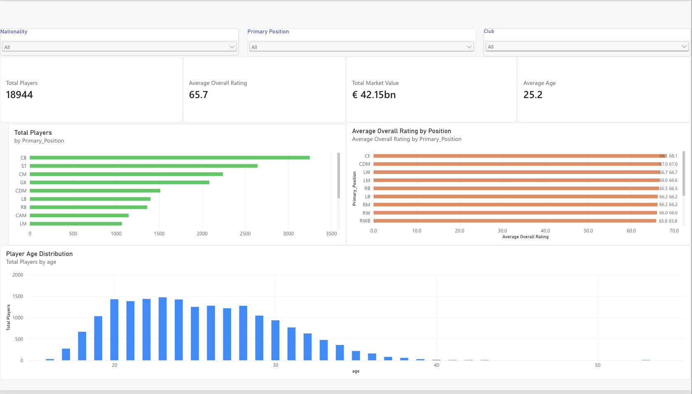
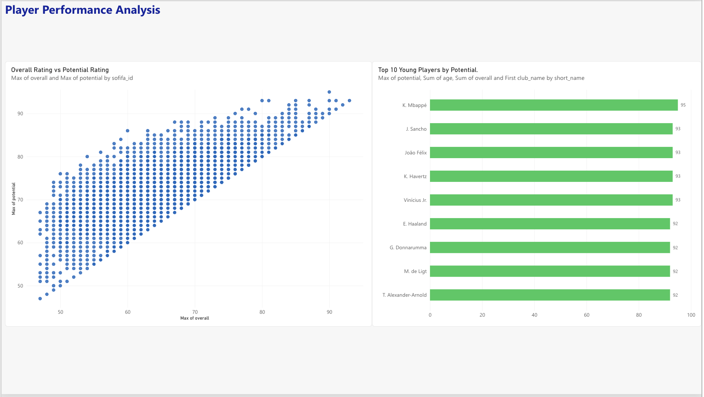
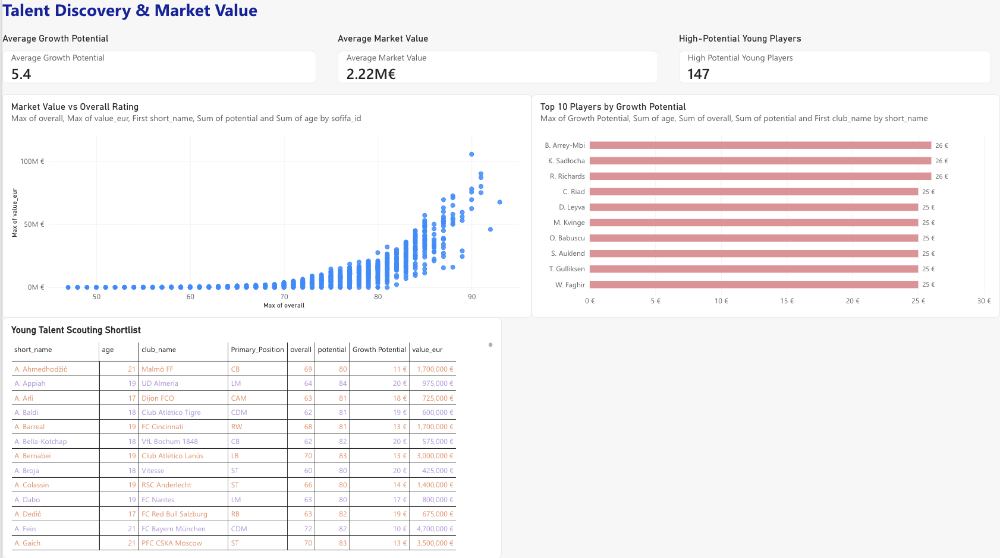

# FIFA 21 Player Analytics & Scouting Dashboard

## Project Overview

An end-to-end football analytics project using **PostgreSQL, SQL, and Power BI** to analyze 18,944 FIFA 21 players.

The project explores player performance, market valuations, wages, positional rankings, and high-potential young talent to support data-driven scouting and recruitment decisions.

## Tools & Technologies

- **PostgreSQL:** Data storage, cleaning, and analytical queries
- **SQL:** CTEs, JOINs, window functions, aggregations, and data transformation
- **Power BI:** Interactive dashboards, KPIs, filters, and visual analysis
- **VS Code & GitHub:** SQL development, documentation, and version control

## Dataset

**Source:** FIFA 21 Complete Player Dataset, available on Kaggle.

- Total player records: 18,944
- Original dataset: 106 columns
- Main attributes: Player ID, Age, Club, League, Overall Rating, Potential Rating, Market Value, Wages, and Playing Position

The project focuses on the FIFA 21 dataset.

## Business Objectives

1. Analyze player ratings and development potential.
2. Identify high-performing players by playing position.
3. Discover promising young players for recruitment.
4. Compare market valuations and wages.
5. Analyze squad values and league-level performance.
6. Identify affordable recruitment candidates using SQL.

## Executive KPI Summary

| KPI | Result |
|---|---:|
| Players Analyzed | 18,944 |
| Total Estimated Market Value | €42.15B |
| Average Overall Rating | 65.7 |
| Average Player Age | 25.2 years |
| Average Growth Potential | 5.4 rating points |
| High-Potential Young Players | 147 |

The KPIs summarize the FIFA 21 player dataset and previously reported Power BI dashboard results. Growth potential is calculated as the difference between potential and overall ratings. The high-potential player count should be checked against the dashboard's exact filters.

## Power BI Dashboards

### Dashboard 1 — Player Overview

Analyzes the player population, average rating, age distribution, market value, and playing positions.

### Dashboard 2 — Player Performance

Explores current ratings versus potential ratings, young player performance, and scouting comparisons.

### Dashboard 3 — Talent Discovery & Market Value

Focuses on growth potential, promising young players, market valuations, and recruitment opportunities.

## Key Analytical Findings

### 1. Club Market Value Analysis

Liverpool had the highest estimated squad market value in the dataset at **€840.63 million**, followed by Real Madrid (€760.85M) and Manchester City (€747.28M).

The five highest-valued clubs were:

| Club | Estimated Squad Value |
|---|---:|
| Liverpool | €840.63M |
| Real Madrid | €760.85M |
| Manchester City | €747.28M |
| FC Barcelona | €722.20M |
| FC Bayern München | €609.70M |

**Business insight:** Estimated squad market values provide a benchmark for comparing clubs' player-asset valuations and evaluating relative recruitment spending capacity. They do not measure actual transfer budgets.

### 2. League Performance Analysis

Among leagues with at least 100 players in the dataset, the English Premier League recorded the highest average overall player rating at **73.11**.

| League | Average Overall Rating |
|---|---:|
| English Premier League | 73.11 |
| Spain Primera Division | 72.78 |
| German 1. Bundesliga | 71.66 |
| Italian Serie A | 71.47 |
| Campeonato Brasileiro Série A | 71.10 |

**Business insight:** League-level average ratings can support initial talent benchmarking, although comparisons should account for squad composition and differences in the number of players represented.

### 3. Player Rating vs. Market Value

| Player Rating Segment | Average Estimated Market Value |
|---|---:|
| Elite (85+) | €46.33M |
| High (75–84) | €10.48M |
| Mid (65–74) | €1.69M |
| Developing (below 65) | €0.31M |

Elite-rated players had approximately **4.42 times** the average estimated market value of players in the 75–84 rating segment.

**Business insight:** Market values increase substantially across higher performance-rating segments. Clubs can use rating and valuation comparisons to identify candidates within different budget ranges.

### 4. Young Talent Discovery

Applied SQL-based recruitment filters:

- Age: 23 years or younger
- Potential rating: at least 80
- Overall rating: at least 65
- Estimated market value: €1M–€15M

The five highest-ranked candidates from this query were:

| Player | Potential Rating |
|---|---:|
| Ansu Fati | 90 |
| T. Almada | 89 |
| T. Kubo | 89 |
| M. Greenwood | 89 |
| R. Cherki | 88 |

**Business insight:** Combining player age, potential, current performance, and estimated market value produces a focused scouting shortlist instead of ranking players on potential alone.

## Business Recommendations

1. **Prioritize value-based scouting:** Combine potential ratings, current performance, and estimated market values to screen recruitment candidates.
2. **Benchmark by player segment:** Compare players within similar rating bands rather than relying on overall market value alone.
3. **Use league-level performance comparisons:** Identify leagues with strong average player ratings as starting points for scouting research.
4. **Apply budget constraints:** Use SQL filters to generate candidate shortlists aligned with estimated recruitment budgets.
5. **Use interactive dashboards for decision support:** Explore player attributes, clubs, leagues, and market-value patterns through Power BI.

These recommendations are analytical applications of the FIFA 21 dataset, not claims of demonstrated real-world recruitment outcomes.

## SQL Analysis

The project contains five organized SQL analysis scripts.

| SQL File | Description |
|---|---|
| `01_data_quality.sql` | Data validation, missing-value checks, and cleaned-table creation |
| `02_player_performance.sql` | Player rankings, positional performance, and young talent |
| `03_market_value_analysis.sql` | Market values, wages, and affordable recruitment |
| `04_club_league_analysis.sql` | Club valuations, league comparisons, and emerging talent |
| `05_advanced_scouting.sql` | CTEs, JOINs, window functions, and recruitment shortlists |

The `fifa_create_raw_table.sql` script defines the raw PostgreSQL staging table.

## Data Cleaning & Transformation

- Imported the FIFA 21 dataset into PostgreSQL.
- Validated player counts and unique identifiers.
- Checked missing values and player rating ranges.
- Converted numerical attributes from text into appropriate SQL data types.
- Created an analysis-ready player table.
- Calculated growth potential as `potential - overall`.

## How to Reproduce the SQL Analysis

1. Install PostgreSQL and create a database named `fifa_player_analytics`.
2. Execute `fifa_create_raw_table.sql` to create the raw staging table.
3. Import the FIFA 21 `players_21.csv` dataset into `public.players_21_raw`.
4. Execute `sql/01_data_quality.sql` after reviewing the data-validation results.
5. Execute the remaining SQL scripts in numerical order.

The Power BI dashboards are documented through screenshots.

## Skills Demonstrated

- SQL data cleaning and transformation
- Data quality validation
- Aggregations and conditional filtering
- Common Table Expressions (CTEs)
- SQL window functions
- Player and market segmentation
- Business KPI analysis
- Power BI dashboard development
- Data storytelling and documentation

## Project Scope

This project uses FIFA 21 player attributes and estimated market valuations. Recruitment shortlists are analytical examples, not predictions of real-world transfers or confirmed transfer prices.
